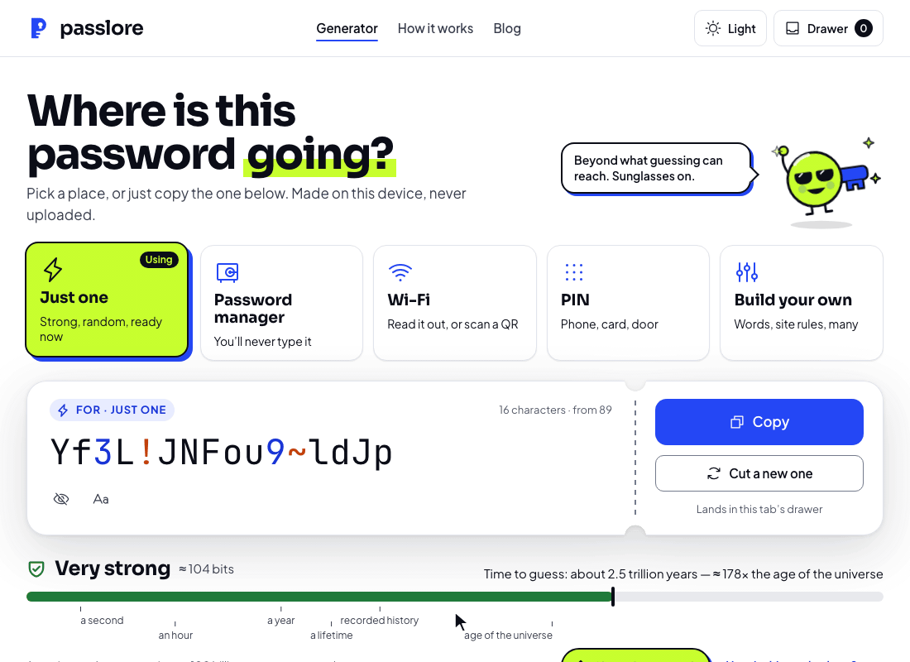
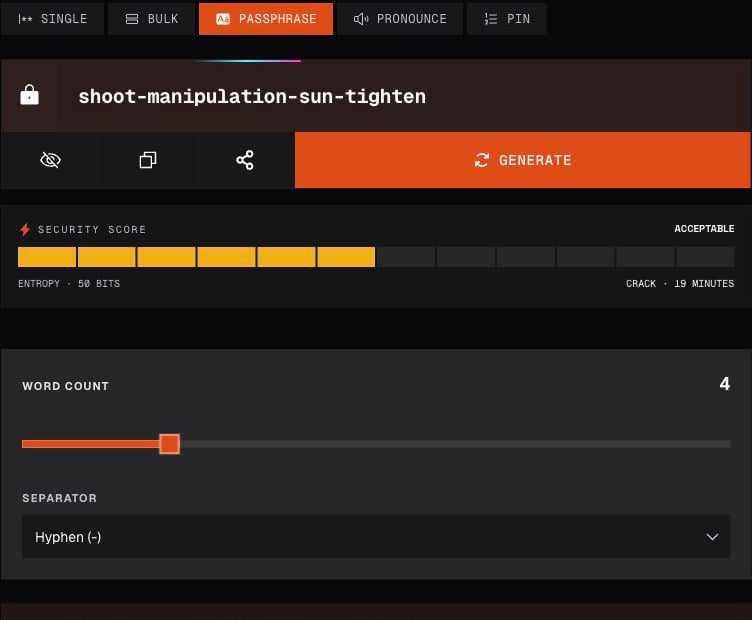

<p align="center">
  <a href="https://passlore.com/"></a>
</p>

<h1 align="center">Passlore</h1>
<h3 align="center">Your next password starts in your browser.</h3>

<p align="center">
  Generate passwords, passphrases and PINs without creating an account.<br>
  Tune the format, inspect the estimate, and copy the result when you are ready.
</p>

<p align="center">
  <a href="https://passlore.com/"><b>Try Passlore</b></a> ·
  <a href="https://play.passlore.com/">Testing environment</a> ·
  <a href="#documentation">Documentation</a> ·
  <a href="https://github.com/SoubhikBiswas-gitHub/passlore/issues">Report an issue</a>
</p>

<p align="center">
  <a href="package.json"></a>
  <a href="#quick-start"></a>
  <a href="#privacy-and-security-boundaries"></a>
</p>

[](https://passlore.com/)

*Captured from the live product. Every value shown in these images is a demonstration value; never use it as a password.*

**Explore:** [Demo](#see-it-in-action) · [Features](#what-you-can-generate) · [Quick start](#quick-start) · [Commands](#development-commands) · [Deployment](#environments-and-deployment) · [Codebase](#architecture-and-repository-map) · [Help](#troubleshooting)

## See it in action



**Single → Passphrase → PIN.** The animation combines real browser captures with shortened pauses. It shows the product as it works, without a simulated interface or an embedded video player. [Open the full-size preview](.github/readme/generator-demo.gif).

To try it yourself:

1. Open [Passlore](https://passlore.com/) and choose a mode.
2. Set the length or word count and adjust the options.
3. Press **Generate**, then use **Copy password** when ready. Changing options also regenerates the output.

<details>
<summary><b>A closer look at passphrase mode</b></summary>



Choose three to eight words and a hyphen, dot, underscore or space separator. The words are selected from the checked-in [word list](lib/words.ts). This is a random-word mode, not a phrase you invent yourself.

</details>

## Why Passlore

Different forms need different kinds of secrets. One may accept symbols, another may limit length, and a device may ask for digits only. Passlore puts those controls beside the output, with a separate passphrase mode for word-based secrets and a bulk mode for generating a list.

Generation runs locally using the browser's **Web Crypto API**. Random indices use rejection sampling, which discards values that would make some choices more likely than others. No generation request sends the password to a Passlore server.

Passlore is a generator, not a password vault. Store anything you need to keep in a password manager. Its entropy and crack-time displays are estimates, not a security audit or a promise about a real attack.

## What you can generate

| Mode | What it does | Useful controls |
| --- | --- | --- |
| **Single** | Generate one random password | Length, uppercase/lowercase letters, digits and symbols |
| **Bulk** | Generate up to 500 passwords | Copy individual entries or the whole list; download plain text or JSON |
| **Passphrase** | Select random words from the bundled list | Word count and separator |
| **Pronounce** | Alternate random consonants and vowels | Length; a restricted format rather than arbitrary character selection |
| **PIN** | Generate random decimal digits | PIN length |

Other implemented controls include:

- **Advanced parameters:** exclude similar or ambiguous characters, exclude specific characters, insert fixed text, and set a prefix or suffix.
- **Optional breach lookup:** check the current output in Single or Bulk mode against Have I Been Pwned's Pwned Passwords service. In Bulk mode this checks the current output, not every item in the list.
- **Session history:** keep up to 20 recent outputs in the tab's session storage, with a clear control.
- **Copy, reveal and share:** copy the result, toggle its display, or explicitly invoke the browser's share flow. Bulk exports are ordinary, unencrypted files.
- **Themes and reading:** light/dark/system appearance, explanatory pages and password-security articles.

All generator modes are available in the web tool. There is no paid tier, checkout, browser extension, embeddable widget or separately published library in this repository.

## Privacy and security boundaries

| Action | What happens to the data |
| --- | --- |
| **Generate** | The browser assembles the output using `crypto.getRandomValues`. Generation does not call a server. |
| **Keep recent results** | Generated values are stored in plaintext in this tab's `sessionStorage`, under `ssp-history`. It is not an encrypted vault. |
| **Copy / share / export** | These actions deliberately put the value on the clipboard, in the chosen share destination, or in a downloaded file. |
| **Run the optional breach check** | The browser computes SHA-1 and sends only its first five hexadecimal characters to the Pwned Passwords range API, with response padding requested. Matching the remaining hash happens locally. |
| **Consent and analytics** | The browser remembers the consent choice. Production analytics loads only when configured and accepted; testing disables that integration. See the hosted privacy policy for the full site policy. |

A breach service response cannot establish that a password is safe. A connection failure is an unknown result, not a clean result. Likewise, a fixed prefix, constrained format or pronounceable pattern changes unpredictability; do not treat a displayed estimate as a certification.

The project does not currently use a server database, object-storage service or payment integration. See [Privacy](https://passlore.com/privacy), [About](https://passlore.com/about), and the implementation in [`lib/hibp.ts`](lib/hibp.ts), [`lib/unbiased-random.ts`](lib/unbiased-random.ts) and [`components/PasswordGenerator.tsx`](components/PasswordGenerator.tsx).

## Quick start

Use **Node.js 22** (the version used in CI), **Yarn Classic 1.22** and Git. Next.js itself declares Node.js 20.9 or newer; Node.js 22 is the tested project path.

From a terminal with access to this GitHub repository:

```bash
git clone https://github.com/SoubhikBiswas-gitHub/passlore.git
cd passlore
yarn install --frozen-lockfile
yarn dev
```

Open **[http://localhost:3000](http://localhost:3000)**. Keep the terminal running while developing; press **Ctrl+C** to stop it. If Yarn is missing, install Yarn Classic with `npm install --global yarn@1.22.22` first.

**The local generator needs no account, API key or Cloudflare login.** Internet access is needed for installing dependencies, fetching fonts during a build, and the optional breach service. Cloudflare credentials are needed only for authenticated hosting operations.

## Development commands

Run commands from the **repository root**. [`package.json`](package.json) is the source of truth for scripts.

| Command | Purpose |
| --- | --- |
| `yarn dev` | Start Next.js with Turbopack at port 3000. |
| `yarn lint` | Run TypeScript with `tsc --noEmit`; this script is a type check, not ESLint. |
| `yarn test` | Run generator tests with Playwright's unit project. No browser installation is needed for these tests. |
| `yarn build` | Create the standard Next.js build. |
| `yarn start` | Serve a standard Next.js build locally. |
| `yarn build:cloudflare` | Build Next.js and the OpenNext Worker bundle. |
| `yarn build:play` | Build the Worker bundle with testing URLs, indexing restrictions and analytics disabled. |
| `yarn preview` | Build and preview the production configuration in the Workers runtime. |
| `yarn test:browser` | Run Chromium checks against an already-built Worker bundle. |
| `yarn icons` | Regenerate browser and mobile icons from `public/icon.svg`. |
| `yarn deploy:play` | Build and deploy the named testing Worker. |
| `yarn deploy` | Build and deploy the production Worker; use only after tested changes are promoted. |

The Cloudflare output is written to `.open-next/`. Both environment builds use that directory: build and deploy one environment at a time.

## Environments and deployment

| Environment | Branch | Address | Worker |
| --- | --- | --- | --- |
| Local | Working tree | `http://localhost:3000` | Next.js development server |
| **Testing** | **`play`** | **[play.passlore.com](https://play.passlore.com/)** | `passlore-play` |
| **Production** | **`main`** | **[passlore.com](https://passlore.com/)** | `passlore` |

Testing uses `noindex` metadata, an `X-Robots-Tag` response header and a disallow-all `robots.txt`. Production analytics is disabled there. **Testing is publicly reachable:** preventing search indexing does not restrict access.

Promote work in this order:

1. Make changes on `play` and run the [required checks](#testing-and-quality).
2. Deploy testing with `yarn deploy:play` and verify the affected flows.
3. Open a pull request from **`play` to `main`**. The workflow rejects production pull requests from other branch names.
4. Merge reviewed changes after checks pass, then deploy production.
5. Fast-forward `play` to the merged `main` commit so both branches start the next change together.

Keep only these two long-lived branches. Branch protection is not configured by request.

<details>
<summary><b>Cloudflare, DNS and automated deployment setup</b></summary>

[Wrangler configuration](wrangler.jsonc) defines the Worker entry point, asset binding, routes and the `play` environment. [OpenNext configuration](open-next.config.ts) adapts the existing Next.js routes and rendering to Cloudflare Workers. Preserve `keep_names: false`; the deployed theme script depends on the resulting bundle behaviour.

DNS uses proxied CNAMEs: root and `www` point to `passlore.soubhik481.workers.dev`, and `play` points to `passlore-play.soubhik481.workers.dev`. The configured Worker routes serve the custom hostnames. The production default `workers.dev` address and version preview URLs are disabled; the CNAME target is still a routing detail, not a second public product URL.

The [GitHub workflow](.github/workflows/deploy.yml) validates pushes to both branches and pull requests into `main`. Its deployment job is conditional:

1. Create GitHub environments named `play` and `production`.
2. Add a separate `CLOUDFLARE_API_TOKEN` secret to each, scoped to the hosting account with Workers Scripts Edit, Workers Routes Edit and Zone Read for the domain.
3. Set the repository variable `CLOUDFLARE_DEPLOY_ENABLED=true` when both environments are ready.

Until that variable is enabled, validation runs and deployment jobs are skipped. Never store a local OAuth session token in GitHub. Hosting uses the service account; registrar access uses the separate domain account. Verify the active account before changing either service.

No database, object-storage or payment bindings exist today. If those are added, provision separate test resources, credentials and payment sandbox settings before enabling them.

</details>

## Architecture and repository map

Next.js serves the pages and metadata. React components provide the interactive generator; the generation functions run in the browser. OpenNext packages the site for Cloudflare Workers. The Worker serves the application, not a password-generation API.

```text
passlore/
├── app/                    Next.js routes, layouts, metadata and styling
│   ├── page.tsx            Generator landing page
│   ├── about/              Generation and security explanation
│   ├── blog/               Article index and individual posts
│   ├── privacy/            Privacy policy
│   └── terms/              Hosted-service terms
├── components/             Generator, controls, history and shared UI
├── lib/                    Random generation, passphrases, entropy and HIBP lookup
├── public/                 Icons, manifest and article imagery
├── scripts/                Reproducible icon generation
├── tests/                  Generator and browser checks
├── .github/workflows/      Validation and conditional deployments
├── open-next.config.ts     Next.js-to-Workers adapter configuration
└── wrangler.jsonc          Worker assets, environments and custom-domain routes
```

Start with [`components/PasswordGenerator.tsx`](components/PasswordGenerator.tsx) for state and orchestration, then [`lib/generate.ts`](lib/generate.ts), [`lib/passphrase.ts`](lib/passphrase.ts) and [`lib/unbiased-random.ts`](lib/unbiased-random.ts) for generation. UI controls live beside the main component. [`lib/seo.ts`](lib/seo.ts) centralizes site metadata and environment-aware indexing.

The main stack is **Next.js 16, React 19, TypeScript, Tailwind CSS 4 and Cloudflare Workers**, with Radix controls and Phosphor icons. No package publication or external SDK integration is required to run the app.

## Configuration

No configuration file is required for basic generation. Optional settings are build-time environment variables:

| Variable | Purpose |
| --- | --- |
| `NEXT_PUBLIC_DEPLOYMENT_ENV=play` | Select testing metadata and disable production analytics. |
| `NEXT_PUBLIC_SITE_URL=https://play.passlore.com` | Set the site's canonical base URL for the testing build. |
| `NEXT_PUBLIC_GA_MEASUREMENT_ID` | Optional production analytics identifier; the script also requires consent. Leave unset to omit analytics. |
| `PLAYWRIGHT_BASE_URL` | Point browser checks at a deployed site instead of starting the local preview. |

The `build:play` script sets the first two variables for you. For local overrides use `.env.local`, which is ignored by Git. Values prefixed `NEXT_PUBLIC_` can appear in the browser bundle; never put secrets there.

Cloudflare deployment credentials belong in the shell's authenticated session or the named GitHub environment secrets, not in client configuration.

## Testing and quality

The checks verify different boundaries:

| Check | Evidence it provides |
| --- | --- |
| Type checking | Components and helpers satisfy TypeScript's declared types. |
| Generator tests | Character exclusions, fixed fragments, PIN/passphrase formats and rejection sampling behave as expected. |
| Chromium checks | The generator loads without page errors, regenerates, switches modes, and serves public routes; testing retains indexing and analytics restrictions. |
| Live smoke checks | A specific deployment serves the expected pages and headers. This is separate from local test success. |

Install Chromium once, then run the promotion checks:

```bash
yarn playwright install chromium
yarn lint
yarn test
yarn build:play
NEXT_PUBLIC_DEPLOYMENT_ENV=play yarn test:browser
```

The last command assumes macOS/Linux shell syntax. On Windows, set `NEXT_PUBLIC_DEPLOYMENT_ENV` to `play` using your shell before invoking `yarn test:browser`.

Browser checks use the Workers runtime at `http://127.0.0.1:3100`. Use `PLAYWRIGHT_BASE_URL` to target an existing deployment; keep the environment variable consistent with the target. The suite does not prove clipboard behaviour, native sharing, the live breach service or every browser/device combination. Generator tests are not an independent cryptographic audit.

## Troubleshooting

| Symptom | Check or fix |
| --- | --- |
| Copy or Share is unavailable | Use HTTPS or localhost, allow clipboard access when appropriate, and check browser support. Share falls back to copying when native sharing is unavailable. |
| The breach check fails | Check network access to `api.pwnedpasswords.com`. A failed lookup is not evidence that the password is absent from the dataset. |
| Browser tests cannot find Chromium | Run `yarn playwright install chromium`, then retry. |
| Browser checks fail to start port 3100 | Finish `yarn build:play` first and check whether another process is using the port. |
| A build cannot download fonts | Next.js downloads its configured Google Fonts at build time. Check network/proxy access, then rebuild. |
| A testing page looks different from production | Verify the branch, selected build environment and deployed Worker before comparing. |
| The default production Worker address returns 404 | Expected: use `passlore.com`. The provider URL is disabled intentionally. |
| GitHub validation passes but no release appears | Check the deployment-enable variable and the two environment secrets; validation alone does not publish a Worker. |

## Contributing and project status

Start with a focused bug report or small improvement. In an [issue](https://github.com/SoubhikBiswas-gitHub/passlore/issues), include the affected URL, browser/OS, reproduction steps, expected result and a screenshot with sensitive values removed. Propose larger changes before implementing them.

Use `play`, keep changes grouped into meaningful commits, run the required checks, and promote through a pull request to `main`. Include screenshots for visible changes and an honest validation summary. Use neutral names and omit attribution trailers. [AGENTS.md](AGENTS.md) records the repository workflow.

**Implemented:** the web generator modes, local session history, optional breach lookup, informational pages, themed UI and separate production/testing Workers.

**Operational follow-up:** automated deployment stays conditional on environment credentials; there is no maintained public roadmap or release promise. There are no `CONTRIBUTING.md` or `SECURITY.md` files at present. Do not infer a published package, approved extension or paid release from future ideas.

## Documentation

| Topic | Reference |
| --- | --- |
| Using the tool and its limits | [About Passlore](https://passlore.com/about) and [articles](https://passlore.com/blog) |
| Privacy and service terms | [Privacy](https://passlore.com/privacy) · [Terms](https://passlore.com/terms) |
| Working in this repository | [Quick start](#quick-start) · [commands](#development-commands) · [AGENTS.md](AGENTS.md) |
| Generation and breach lookup | [`lib/generate.ts`](lib/generate.ts) · [`lib/passphrase.ts`](lib/passphrase.ts) · [`lib/hibp.ts`](lib/hibp.ts) |
| Tests | [`tests/`](tests) · [`playwright.config.ts`](playwright.config.ts) |
| Hosting and promotion | [Deployment](#environments-and-deployment) · [workflow](.github/workflows/deploy.yml) · [Wrangler](wrangler.jsonc) |
| Icon source | [`public/icon.svg`](public/icon.svg) · [`scripts/build-icons.mjs`](scripts/build-icons.mjs) |

## Support, security and licence

Passlore is open source. Use [repository issues](https://github.com/SoubhikBiswas-gitHub/passlore/issues) for ordinary bugs and questions, and submit contributions through a pull request against `play`.

No dedicated security-disclosure policy or security contact is defined in this repository. Do not post live passwords, licence keys, tokens or personal data in an issue. The hosted [privacy policy](https://passlore.com/privacy) lists a contact for privacy matters.

Passlore is available under the [MIT License](LICENSE). You may use, modify and redistribute the code under that licence. Third-party dependencies retain their own licences. The hosted [terms](https://passlore.com/terms) describe use of the service and are separate from source-code licensing.
