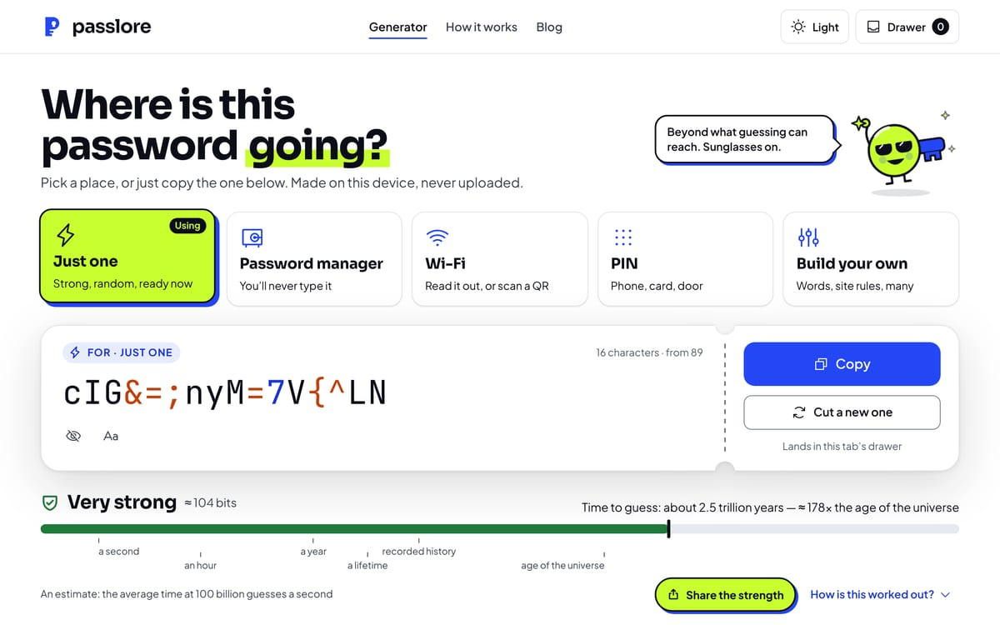

<p align="center">
  <a href="https://passlore.com/"></a>
</p>

<h1 align="center">Passlore</h1>
<h3 align="center">Your next password starts in your browser.</h3>

<p align="center">
  Pick where the password is going, and Passlore cuts one to suit it: a password, a passphrase or a PIN.<br>
  No account, nothing uploaded. Read the strength in plain words, then copy it when you are ready.
</p>

<p align="center">
  <a href="https://passlore.com/"><b>Try Passlore</b></a> ·
  <a href="https://play.passlore.com/">Testing environment</a> ·
  <a href="#documentation">Documentation</a> ·
  <a href="https://github.com/SoubhikBiswas-gitHub/passlore/issues">Report an issue</a>
</p>

<p align="center">
  <a href="package.json"></a>
  <a href="#quick-start"></a>
  <a href="#privacy-and-security-boundaries"></a>
</p>

[](https://passlore.com/)

*Captured from a production build. Every value shown in these images is a demonstration value; never use it as a password.*

**Explore:** [Demo](#see-it-in-action) · [Features](#what-you-can-generate) · [Quick start](#quick-start) · [Commands](#development-commands) · [Deployment](#environments-and-deployment) · [Codebase](#architecture-and-repository-map) · [Help](#troubleshooting)

## See it in action


**Just one → Copy → Wi-Fi → PIN → Build your own → Fit site rules.** A real browser recording of the production build in the light theme; only the pointer is drawn in. Copy turns green and lists what to do next. The last step pastes a site's rules ("8-16 characters … one special character (!@#$%) …"), and Passlore cuts the longest password they allow and ticks off each rule. [Open the full-size preview](.github/readme/generator-demo.gif).

To try it yourself:

1. Open [Passlore](https://passlore.com/). A 16-character password is already on the ticket.
2. Pick where it is going from the deck: **Just one**, **Password manager**, **Wi-Fi**, **PIN**, or **Build your own**.
3. Press **Copy**, or **Cut a new one** for another. Changing a setting also cuts a new password.

<details>
<summary><b>A closer look at the Wi-Fi recipe</b></summary>


Wi-Fi uses six random words from the EFF long word list, joined by a hyphen, dot, underscore or space. Type the network name and Passlore draws a QR code that phones can scan to join. **Show big** displays the password in large type for reading out, and **Guest poster** opens a printable sign with the QR code, network name and password. The network name stays on the device.

</details>

## Why Passlore

A bank login, a Wi-Fi router and a phone lock need different kinds of secrets. Passlore starts by asking where the password is going and picks a sensible recipe for it: long random characters for a password manager, words you can read out for Wi-Fi, digits for a PIN. When a site has its own rules, paste them and Passlore fits the password to them.

Generation runs locally using the browser's **Web Crypto API**. Random indices use rejection sampling, which discards values that would make some choices more likely than others. No generation request sends the password to a Passlore server, and every recipe keeps working offline.

Passlore is a generator, not a password vault. Store anything you need to keep in a password manager. Its strength and time-to-guess displays are estimates, not a security audit or a promise about a real attack.

## What you can generate

The generator opens on a deck of recipes. **Build your own** has four kinds of its own.

| Recipe | What it makes | Useful controls |
| --- | --- | --- |
| **Just one** | 16 random characters from uppercase, lowercase, digits and symbols | Length 8–64, symbols on or off, avoid look-alikes (`0 O o 1 l I \|`) |
| **Password manager** | 32 random characters, for a manager to fill in | Length 16–128 |
| **Wi-Fi** | Six random words joined by hyphens | 4–9 words, separator, network name for a QR code, **Show big**, printable guest poster, 8–63 character check |
| **PIN** | Six random digits, skipping obvious PINs such as 1234, 0000, 1212, 2580 and years | 4, 6 or 8 digits; obvious-PIN skipping can be turned off |
| **Build your own → Characters** | Random characters from the types you choose | Length 4–128, each character type, avoid look-alikes, never-use characters, must-include text, prefix and suffix |
| **Build your own → Words** | A passphrase of random words | 3–10 words and the separator |
| **Build your own → Fit site rules** | The longest password a site's rules allow, using every character type they accept | Paste the rules, or set length, required types, accepted symbols and "starts with a letter" by hand; a checklist confirms the fit, and conflicting rules come with a one-tap fix |
| **Build your own → Many at once** | Up to 500 random passwords, each cut independently | How many, length 8–64; copy one or all; export `.txt`, `.csv` or `.json` |

Words come from the [EFF long word list](lib/generator/eff-long-wordlist.ts): 7,771 of its 7,776 words, leaving out "undefined" and the four hyphenated words. A shorter built-in list covers the moment before the full list loads. Recipes can also be opened from a link, such as `https://passlore.com/#r=wifi`.

Around the password:

- **The ticket:** Copy, Cut a new one, hide the password from onlookers, and spell it out with the phonetic alphabet (read aloud where the browser supports speech).
- **Strength in plain words:** a rating from Very weak to Very strong, the estimated time to guess it at 100 billion guesses a second, and **How is this worked out?** for the arithmetic.
- **Next steps after copying:** short steps for the recipe (for example, change the password in your router's settings), plus an optional switch that clears the clipboard 60 seconds after copying.
- **Optional leak check:** look up the current password in Have I Been Pwned's Pwned Passwords data. With Many at once it checks the first password in the list.
- **The drawer:** the last 20 passwords you copied or cut in this tab, with a control to empty it.
- **Share the strength:** share, save or copy a card showing how strong the password is. The card never contains the password.
- **Themes and reading:** Auto, Light, Dark, Sepia and High contrast themes, Lore the mascot reacting to the strength, a [How it works](https://passlore.com/how-it-works) page and password-security articles.

All recipes are available in the web tool. There is no paid tier, checkout, browser extension, embeddable widget or separately published library in this repository.

## Privacy and security boundaries

| Action | What happens to the data |
| --- | --- |
| **Generate** | The browser assembles the output using `crypto.getRandomValues`. Generation does not call a server. |
| **Paste site rules / type a network name** | The rules text is read and the QR code is drawn on the device. Neither is sent anywhere. |
| **Keep recent results** | Copied and newly cut passwords are stored in plaintext in this tab's `sessionStorage`, under `passlore:drawer`, up to 20 items. Browsers normally drop it when the tab closes, but restoring a closed tab or session can bring it back, so empty the drawer when you're done. It is not an encrypted vault. |
| **Copy / export / print** | These actions deliberately put the value on the clipboard, in a downloaded file or on a printed poster. The optional clipboard clear overwrites the clipboard after 60 seconds, but only works while the tab has focus. Exports are ordinary, unencrypted files. |
| **Share the strength** | The shared text and image contain the strength rating and time estimate, never the password. |
| **Run the optional leak check** | Only when you press Check, the browser computes SHA-1 and sends only its first five hexadecimal characters to the Pwned Passwords range API, with the `Add-Padding` header so the response size gives nothing away. Matching the remaining hash happens locally. |
| **Consent, theme and analytics** | The browser remembers the consent and theme choices in `localStorage`. Production analytics loads only when configured and accepted; testing disables that integration. See the hosted privacy policy for the full site policy. |

A leak-service response cannot establish that a password is safe. A connection failure or an unreadable response is an unknown result, not a clean result. Likewise, fixed text, a prefix or suffix, or a site's narrow rules reduce unpredictability; do not treat a displayed estimate as a certification. A PIN is only safe where the device limits wrong guesses.

The project does not currently use a server database, object-storage service or payment integration. See [Privacy](https://passlore.com/privacy), [How it works](https://passlore.com/how-it-works), and the implementation in [`lib/generator/random.ts`](lib/generator/random.ts), [`lib/generator/leakCheck.ts`](lib/generator/leakCheck.ts) and [`components/generator/Generator.tsx`](components/generator/Generator.tsx).

## Quick start

Use **Node.js 22** (the version used in CI), **Yarn Classic 1.22** and Git. Next.js itself declares Node.js 20.9 or newer; Node.js 22 is the tested project path.

From a terminal with access to this GitHub repository:

```bash
git clone https://github.com/SoubhikBiswas-gitHub/passlore.git
cd passlore
yarn install --frozen-lockfile
yarn dev
```

Open **[http://localhost:3000](http://localhost:3000)**. Keep the terminal running while developing; press **Ctrl+C** to stop it. If Yarn is missing, install Yarn Classic with `npm install --global yarn@1.22.22` first.

**The local generator needs no account, API key or Cloudflare login.** Internet access is needed for installing dependencies, fetching fonts during a build, and the optional leak check. Cloudflare credentials are needed only for authenticated hosting operations.

## Development commands

Run commands from the **repository root**. [`package.json`](package.json) is the source of truth for scripts.

| Command | Purpose |
| --- | --- |
| `yarn dev` | Start Next.js with Turbopack at port 3000. |
| `yarn lint` | Run TypeScript with `tsc --noEmit`; this script is a type check, not ESLint. |
| `yarn test` | Run the 22 generator unit tests in `tests/generation.spec.ts` with Playwright's unit project. No browser installation is needed for these tests. |
| `yarn build` | Create the standard Next.js build. |
| `yarn start` | Serve a standard Next.js build locally. |
| `yarn build:cloudflare` | Build Next.js and the OpenNext Worker bundle. |
| `yarn build:play` | Build the Worker bundle with testing URLs, indexing restrictions and analytics disabled. |
| `yarn preview` | Build and preview the production configuration in the Workers runtime. |
| `yarn test:browser` | Run the Chromium checks in `tests/browser.spec.ts` against an already-built Worker bundle. |
| `yarn icons` | Regenerate `favicon.ico` and the PNG app icons in `public/` from the mark drawn in `scripts/build-icons.mjs`. |
| `yarn deploy:play` | Build and deploy the named testing Worker. |
| `yarn deploy` | Build and deploy the production Worker; use only after tested changes are promoted. |

The Cloudflare output is written to `.open-next/`. Both environment builds use that directory: build and deploy one environment at a time.

## Environments and deployment

| Environment | Branch | Address | Worker |
| --- | --- | --- | --- |
| Local | Working tree | `http://localhost:3000` | Next.js development server |
| **Testing** | **`play`** | **[play.passlore.com](https://play.passlore.com/)** | `passlore-play` |
| **Production** | **`main`** | **[passlore.com](https://passlore.com/)** | `passlore` |

Testing uses `noindex` metadata, an `X-Robots-Tag` response header and a disallow-all `robots.txt`. Production analytics is disabled there. **Testing is publicly reachable:** preventing search indexing does not restrict access.

Promote work in this order:

1. Make changes on `play` and run the [required checks](#testing-and-quality).
2. Deploy testing with `yarn deploy:play` and verify the affected flows.
3. Open a pull request from **`play` to `main`**. The workflow rejects production pull requests from other branch names.
4. Merge reviewed changes after checks pass, then deploy production.
5. Fast-forward `play` to the merged `main` commit so both branches start the next change together.

Keep only these two long-lived branches. Branch protection is not configured by request.

<details>
<summary><b>Cloudflare, DNS and automated deployment setup</b></summary>

[Wrangler configuration](wrangler.jsonc) defines the Worker entry point, asset binding, routes and the `play` environment. [OpenNext configuration](open-next.config.ts) adapts the existing Next.js routes and rendering to Cloudflare Workers. Preserve `keep_names: false`; the deployed theme script depends on the resulting bundle behaviour.

DNS uses proxied CNAMEs: root and `www` point to `passlore.soubhik481.workers.dev`, and `play` points to `passlore-play.soubhik481.workers.dev`. The configured Worker routes serve the custom hostnames. The production default `workers.dev` address and version preview URLs are disabled; the CNAME target is still a routing detail, not a second public product URL.

The [GitHub workflow](.github/workflows/deploy.yml) validates pushes to both branches and pull requests into `main`. Its deployment job is conditional:

1. Create GitHub environments named `play` and `production`.
2. Add a separate `CLOUDFLARE_API_TOKEN` secret to each, scoped to the hosting account with Workers Scripts Edit, Workers Routes Edit and Zone Read for the domain.
3. Set the repository variable `CLOUDFLARE_DEPLOY_ENABLED=true` when both environments are ready.

Until that variable is `true`, validation runs and deployment jobs are skipped. Deploy instead with `yarn deploy:play` or `yarn deploy` from a machine signed in to the Cloudflare hosting account. Never store a local OAuth session token in GitHub. Hosting uses the service account; registrar access uses the separate domain account. Verify the active account before changing either service.

No database, object-storage or payment bindings exist today. If those are added, provision separate test resources, credentials and payment sandbox settings before enabling them.

</details>

## Architecture and repository map

Next.js serves the pages and metadata. React components provide the interactive generator; the generation functions run in the browser. OpenNext packages the site for Cloudflare Workers. The Worker serves the application, not a password-generation API.

```text
passlore/
├── app/                        Next.js routes, layouts, metadata and styling
│   ├── page.tsx                Generator landing page
│   ├── how-it-works/           How generation, strength and the leak check work
│   ├── about/                  Renders the same How it works page
│   ├── blog/                   Article index and individual posts
│   ├── privacy/                Privacy policy
│   ├── terms/                  Hosted-service terms
│   └── opengraph-image.tsx     Social preview images (also twitter-image.tsx and per-page versions)
├── components/
│   ├── generator/              Recipe deck, ticket, strength ruler, recipe panels, leak check, drawer
│   ├── content/                How it works page and its live demonstrations
│   ├── blog/                   Article index and article tools
│   ├── legal/                  Privacy and terms layout, analytics choice
│   └── Lore.tsx                The mascot, with moods and scenes
├── lib/
│   ├── generator/              Randomness, recipes, word lists, site rules, strength, leak check, QR, drawer
│   └── seo.ts                  Site metadata and environment-aware indexing
├── public/                     Icons and web app manifest
├── scripts/                    Reproducible icon generation
├── tests/                      Generator unit tests and browser checks
├── .github/workflows/          Validation and conditional deployments
├── open-next.config.ts         Next.js-to-Workers adapter configuration
└── wrangler.jsonc              Worker assets, environments and custom-domain routes
```

Start with [`components/generator/Generator.tsx`](components/generator/Generator.tsx) for state and orchestration, and [`components/generator/recipes.tsx`](components/generator/recipes.tsx) for the recipe deck. The generation code lives in [`lib/generator/`](lib/generator), exported through [`index.ts`](lib/generator/index.ts):

| File | Responsibility |
| --- | --- |
| [`random.ts`](lib/generator/random.ts) | Unbiased random indices with `crypto.getRandomValues` and rejection sampling |
| [`charsets.ts`](lib/generator/charsets.ts) | Character sets and the look-alike characters |
| [`generate.ts`](lib/generator/generate.ts) | Default settings and the generator for every recipe, including obvious-PIN skipping |
| [`wordlist.ts`](lib/generator/wordlist.ts) | Built-in fallback words and lazy loading of the EFF long list |
| [`siteRules.ts`](lib/generator/siteRules.ts) | Reading pasted password rules, applying overrides and finding conflicts |
| [`strength.ts`](lib/generator/strength.ts) | Entropy, strength ratings and time-to-guess wording |
| [`leakCheck.ts`](lib/generator/leakCheck.ts) | SHA-1 hashing and the padded Pwned Passwords range lookup |
| [`shareCard.ts`](lib/generator/shareCard.ts) | Share-the-strength text and image, without the password |
| [`wifi.ts`](lib/generator/wifi.ts) | The Wi-Fi join payload and QR code matrix |
| [`history.ts`](lib/generator/history.ts) | The per-tab drawer in `sessionStorage` |

The header, footer, theme selector and consent panel live in [`components/`](components). [`lib/seo.ts`](lib/seo.ts) centralizes site metadata and environment-aware indexing.

The main stack is **Next.js 16, React 19, TypeScript, Tailwind CSS 4 and Cloudflare Workers**, with Radix dialogs and menus, Phosphor icons, Framer Motion and `qrcode-generator`. No package publication or external SDK integration is required to run the app.

## Configuration

No configuration file is required for basic generation. Optional settings are build-time environment variables:

| Variable | Purpose |
| --- | --- |
| `NEXT_PUBLIC_DEPLOYMENT_ENV=play` | Select testing metadata and disable production analytics. |
| `NEXT_PUBLIC_SITE_URL=https://play.passlore.com` | Set the site's canonical base URL for the testing build. |
| `NEXT_PUBLIC_GA_MEASUREMENT_ID` | Optional production analytics identifier; the script also requires consent. Leave unset to omit analytics. |
| `PLAYWRIGHT_BASE_URL` | Point browser checks at a deployed site instead of starting the local preview. |

The `build:play` script sets the first two variables for you. For local overrides use `.env.local`, which is ignored by Git. Values prefixed `NEXT_PUBLIC_` can appear in the browser bundle; never put secrets there.

Cloudflare deployment credentials belong in the shell's authenticated session or the named GitHub environment secrets, not in client configuration.

## Testing and quality

The checks verify different boundaries:

| Check | Evidence it provides |
| --- | --- |
| Type checking | Components and helpers satisfy TypeScript's declared types. |
| Generator unit tests | 22 tests in [`tests/generation.spec.ts`](tests/generation.spec.ts): rejection sampling, the shape of every recipe's output, the EFF list and fallback words, obvious PINs, Build your own errors, reading and reconciling site rules, strength ratings and time-to-guess wording, share text that never includes the password, Wi-Fi QR escaping, and the leak check's prefix, padding and failure handling. |
| Chromium checks | [`tests/browser.spec.ts`](tests/browser.spec.ts): the generator loads without page errors, cuts a new password and switches to the Wi-Fi and PIN recipes; public routes, the sitemap and the social image respond; testing keeps its indexing and analytics restrictions. |
| Live smoke checks | A specific deployment serves the expected pages and headers. This is separate from local test success. |

Install Chromium once, then run the promotion checks:

```bash
yarn playwright install chromium
yarn lint
yarn test
yarn build:play
NEXT_PUBLIC_DEPLOYMENT_ENV=play yarn test:browser
```

The last command assumes macOS/Linux shell syntax. On Windows, set `NEXT_PUBLIC_DEPLOYMENT_ENV` to `play` using your shell before invoking `yarn test:browser`.

Browser checks use the Workers runtime at `http://127.0.0.1:3100`. Use `PLAYWRIGHT_BASE_URL` to target an existing deployment; keep the environment variable consistent with the target. The suite does not prove clipboard behaviour, native sharing, QR scanning, printing, the live leak-check service or every browser/device combination. Generator tests are not an independent cryptographic audit.

## Troubleshooting

| Symptom | Check or fix |
| --- | --- |
| Copy is unavailable | Use HTTPS or localhost, allow clipboard access when appropriate, and check browser support. If the clipboard cannot be reached, select the password and copy it yourself. |
| The clipboard was not cleared after 60 seconds | Browsers only allow clearing while the tab has focus. Copy something else to overwrite it. |
| Share the strength copies text instead of sharing | The browser has no native share sheet here, so the share text (without the password) is copied instead. |
| The Wi-Fi QR code does not appear | Type the network name first; the QR code needs both the name and the password. |
| The leak check fails | Check network access to `api.pwnedpasswords.com`. A failed lookup is not evidence that the password is absent from the dataset. |
| Browser tests cannot find Chromium | Run `yarn playwright install chromium`, then retry. |
| Browser checks fail to start port 3100 | Finish `yarn build:play` first and check whether another process is using the port. |
| A build cannot download fonts | Next.js downloads its configured Google Fonts at build time. Check network/proxy access, then rebuild. |
| A testing page looks different from production | Verify the branch, selected build environment and deployed Worker before comparing. |
| The default production Worker address returns 404 | Expected: use `passlore.com`. The provider URL is disabled intentionally. |
| GitHub validation passes but no release appears | Check that `CLOUDFLARE_DEPLOY_ENABLED` is `true` and both environment secrets exist; validation alone does not publish a Worker. Otherwise deploy with `yarn deploy:play` or `yarn deploy`. |

## Contributing and project status

Start with a focused bug report or small improvement. In an [issue](https://github.com/SoubhikBiswas-gitHub/passlore/issues), include the affected URL, browser/OS, reproduction steps, expected result and a screenshot with sensitive values removed. Propose larger changes before implementing them.

Use `play`, keep changes grouped into meaningful commits, run the required checks, and promote through a pull request to `main`. Include screenshots for visible changes and an honest validation summary. Use neutral names and omit attribution trailers. [AGENTS.md](AGENTS.md) records the repository workflow.

**Implemented:** the recipe-based web generator, Fit site rules, Many at once with exports, the Wi-Fi QR code and guest poster, the per-tab drawer, the optional leak check, share-the-strength cards, four themes plus Auto, informational pages and separate production/testing Workers.

**Operational follow-up:** automated deployment stays conditional on environment credentials; there is no maintained public roadmap or release promise. Contribution and security guidance live in [CONTRIBUTING.md](CONTRIBUTING.md) and [SECURITY.md](SECURITY.md). Do not infer a published package, approved extension or paid release from future ideas.

## Documentation

| Topic | Reference |
| --- | --- |
| Using the tool and its limits | [How it works](https://passlore.com/how-it-works) and [articles](https://passlore.com/blog) |
| Privacy and service terms | [Privacy](https://passlore.com/privacy) · [Terms](https://passlore.com/terms) |
| Working in this repository | [Quick start](#quick-start) · [commands](#development-commands) · [AGENTS.md](AGENTS.md) |
| Generation, site rules and leak check | [`lib/generator/generate.ts`](lib/generator/generate.ts) · [`lib/generator/siteRules.ts`](lib/generator/siteRules.ts) · [`lib/generator/leakCheck.ts`](lib/generator/leakCheck.ts) |
| Tests | [`tests/`](tests) · [`playwright.config.ts`](playwright.config.ts) |
| Hosting and promotion | [Deployment](#environments-and-deployment) · [workflow](.github/workflows/deploy.yml) · [Wrangler](wrangler.jsonc) |
| Icons | [`public/icon.svg`](public/icon.svg) · [`scripts/build-icons.mjs`](scripts/build-icons.mjs) |

## Support, security and licence

Passlore is open source. Use [repository issues](https://github.com/SoubhikBiswas-gitHub/passlore/issues) for ordinary bugs and questions, and submit contributions through a pull request against `play`.

Report vulnerabilities privately using [SECURITY.md](SECURITY.md). Do not post live passwords, licence keys, tokens or personal data in an issue. The hosted [privacy policy](https://passlore.com/privacy) covers privacy matters.

Passlore is available under the [MIT License](LICENSE). You may use, modify and redistribute the code under that licence. Third-party dependencies retain their own licences. The hosted [terms](https://passlore.com/terms) describe use of the service and are separate from source-code licensing.
